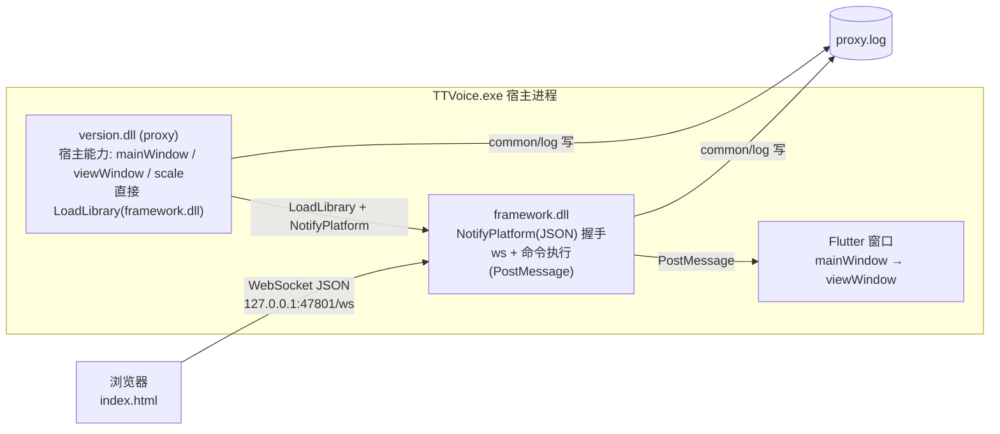

# PlusPlugin 架构（粗粒度）

> 浏览器通过 WebSocket 遥控 TTVoice 宿主窗口。`version.dll`(proxy) 提供宿主能力并直接加载 `framework.dll`；`framework.dll` 提供 WS 服务端与命令执行，两者共用 `common/log` 模块写同一份 `proxy.log`。

## 分层图



## ASCII 版

```
浏览器 (index.html)
   │  WebSocket JSON   ws://127.0.0.1:47801/ws
   ▼
┌────────────────────────── TTVoice.exe 宿主进程 ──────────────────────────┐
│ version.dll (proxy)                                                      │
│   bootstrap: 直接 LoadLibrary(framework.dll) → NotifyPlatform(JSON) 握手  │
│   Host 能力: mainWindow / viewWindow / scale（不含 publishLog）          │
│        │                                                                 │
│        ▼                                                                 │
│ framework.dll                                                            │
│   CivetWeb :47801 (/ws) + 命令执行(mouse/key/delay/geometry, PostMessage)│
│        │ PostMessage                                                     │
│        ▼                                                                 │
│ Flutter 窗口 (mainWindow → viewWindow)                                   │
│                                                                          │
│ 日志: [HH:MM:SS.mmm]-[proxy|framework] ...    → proxy.log（共用 common/log）│
└──────────────────────────────────────────────────────────────────────────┘
```

## 职责

| 组件 | 提供 |
|---|---|
| **proxy** (`version.dll`) | 宿主能力表 `{mainWindow, viewWindow, scale}`；直接 `LoadLibrary(framework.dll)` 并走 `NotifyPlatform` 协议；日志走 `common/log`（`[proxy]`） |
| **framework** (`framework.dll`) | `ws` 服务端、后台命令执行（`PostMessage`）；日志走 `common/log`（`[framework]`）；`publishLog` 仅保留给 `plugin/` 下的插件，框架自身不再经它回写 |

## 模块加载与热加载（`proxy/module_loader`）

“模块”只是一个导出 `NotifyPlatform(const char*, char*, int)` 的 dll，契约全是 JSON：init 里收 `{"cmd":"init","dispatch":"<NotifyGhost 指针>","ctx":"0"}`，之后用 `{"cmd":"mainWindow"|"viewWindow"|"scale"}` 反查宿主能力，退出收 `{"cmd":"shutdown"}`。**没有共享结构体、没有 GetDesc/ABI 校验。**

- `bootstrap` 在宿主 UI 就绪后调 `module_loader::Start(hostContext)`：
  - `framework.dll` 是**核心模块**，总是第一个加载（`protocol::ProtocolStart`，同时绑好 proxy→framework 的转发通道），加载失败要打 WARN；
  - `version.ini [modules]` 里的裸 dll 名是**额外模块**（`protocol::ModuleStart`），可选，缺文件跳过但继续监视。
- 每个模块各有一个 slot，后台线程每 700ms 读它的**文件标识**（卷序列号 + 文件索引 + 大小）；变化且连续两次一致（写完）后：发 `shutdown` → `FreeLibrary`（解除映射）→ 重试 `LoadLibrary` + `init`（10×300ms）→ 删 `<dll>.old`。
- 部署侧配合：`deploy_plugin.py` 用「改名换位」（`framework.dll` → `.old`，新文件放到原名），正好改变文件标识，**部署即热加载**。WS 客户端（`editor2`）用 `reconnecting-websocket` 自动重连，端口 47801 由 CivetWeb 以 `SO_REUSEADDR` 立即重绑。
- 实测：2026-10-28 连续两次替换 framework.dll 均 `hot reload done`，替换后 WS `geometry`/`cursor` 正常回包。

## pplugin 插件机制（已彻底退役，2026-10-28）

- 删掉了 `version.ini [loaders]`、`proxy/plugin.cpp` 的插件加载器、`plugin/example`、`plugin/script-engine`、`libs/nlohmann`，以及契约头 `common/pplugin.h`（`P_ABI` / `Host` / `Desc` / `GetDesc` 全部不再存在）。
- `plugin/console` 已改写成 JSON 模块：导出 `NotifyPlatform`，`{"cmd":"init"}` 里拿 dispatch 指针，用 `{"cmd":"mainWindow"|"viewWindow"|"scale"}` 查宿主能力，用 `{"cmd":"log","tag":"console","text":...}` 写 proxy.log，用 `{"cmd":"logSink","ptr":...}` 订阅日志（`proxy/log_relay` 把 `common/log` 的每行镜像过去）。
- console 自己拥有一个 pump 线程：窗口属于该线程，创建/泵消息/重绘/AutoHide 全在它里面；`{"cmd":"shutdown"}` 里等线程退出再释放资源。
- 启用方式：`version.ini [modules]` 写 `console.dll`，放在 `%APPDATA%\TTVoice\`（与 framework.dll 同目录）。首次启用需重启宿主，之后换文件即热加载。

## WS 协议

端点：`ws://127.0.0.1:47801/ws`，单帧文本 JSON。

**请求**（`type`=类别，`action`=动作）：
```json
{"id":"1","type":"mouse","action":"click","space":"view","x":400,"y":300,"button":"right"}
{"id":"2","type":"mouse","action":"moveTo","space":"view","x":400,"y":300}
{"id":"3","type":"key","vk":65}
{"id":"4","type":"delay","ms":500}
{"id":"5","type":"geometry"}
{"id":"6","type":"mouse","action":"scroll","delta":-120}
{"id":"7","type":"text","text":"hello 你好"}
{"id":"8","type":"cursor"}
```

**回包**（`{id, success, data, code}`，`0000`=成功 / `9999`=失败）：
```json
{"id":"1","success":true,"data":"","code":"0000"}
{"id":"5","success":true,"data":{"x":862,"y":155,"w":2115,"h":1777,"scale":1.5},"code":"0000"}
{"id":"2","success":false,"data":"moveTo needs x,y","code":"9999"}
{"id":"8","success":true,"data":{"sx":1530,"sy":420,"x":301,"y":210,"lx":200.7,"ly":140,"w":2115,"h":1777,"scale":1.5,"inside":true,"f8":false},"code":"0000"}
```

### 取坐标 / 拾取（picker 模块，见 `framework/picker.cpp`）

取点逻辑在 **framework.dll 内部**（`picker.h` / `picker.cpp`），不在 Python 侧：

- 模块自带一条消息循环线程（`SetTimer` 约 30Hz 采样 + 承载 `WH_MOUSE_LL` 钩子）；
- 广播出口由 `framework.cpp` 用 `mg_websocket_write` 实现（`PickerSend`），
  广播时持锁，连接 close 回调也拿同一把锁摘连接，避免写到已回收的 conn。

命令（客户端 -> 服务端）：

```json
{"id":"1","type":"cursor","action":"watch"}
{"id":"2","type":"cursor","action":"unwatch"}
{"id":"3","type":"pick","action":"start"}
{"id":"4","type":"pick","action":"cancel"}
```

主动推送帧（服务端 -> 客户端，**无 id**，不属任何请求的应答）：

```json
{"t":"cursor","sx":1530,"sy":420,"x":301,"y":210,"lx":200.7,"ly":140,"w":2115,"h":1777,"scale":1.5,"inside":true,"f8":false}
{"t":"pick","action":"ready"}
{"t":"pick","sx":1530,"sy":420,"x":301,"y":210,"lx":200.7,"ly":140,"scale":1.5}
{"t":"pick","action":"cancel"}
{"t":"pick","action":"failed","error":"set hook failed"}
```

- `pick/start`：装钩子，下一次落在应用窗口内的**左键被吞掉**（应用不响应）并回传坐标，
  **右键取消**；任一结果都会自动卸钩子；
- `cursor` 订阅是按连接记的，连接断开或 WS 重连后需重新 `watch`（前端 `cursorStore.js` 已处理），
  收不到推送帧时前端自动退回轮询 `{"type":"cursor"}`。

### 取坐标（只读）

`{"type":"cursor"}`（或 HTTP `GET /api/cursor`）只回报真实光标位置，不注入任何鼠标事件、不装钩子、不吞点击：

- `sx/sy`：屏幕坐标；`x/y`：view 客户区物理像素；`lx/ly`：逻辑坐标（`x/scale`，脚本里存这套）；
- `w/h`：view 客户区尺寸；`scale`：DPI 缩放（与 `/api/app`、`geometry` 同源）；
- `inside`：光标是否落在 view 内；`f8`：宿主进程采样的 F8 键态（页面没焦点时浏览器收不到按键，只能由宿主查全局键态）。

editor2 的「添加/修改事件」弹窗（仅 `mouse` 类型）开着时约 70ms 轮询一次：弹窗内直接显示逻辑/物理/屏幕坐标，鼠标停在目标上按 F8 即捕获并回填 X/Y（不用点按钮、页面无需焦点）；也可以在 X 框粘贴 `"lx, ly"` 一次填两格。

## 日志格式

```
[HH:MM:SS.mmm]-[proxy|framework] <正文>
```
- proxy 与 framework 共用 `common/log` 模块，分别打 `[proxy]` / `[framework]`，写入同一 `%APPDATA%\TTVoice\proxy.log`；
- 加载握手时 proxy 还会打 `fw:` / `proto:` 等前缀；framework 不再经 `publishLog` 回写（已去掉订阅/发布往返）。

## 构建 / 部署

```
framework_build.py  ──SSH──► Linux VM ──mingw 静态编译──► framework.dll
proxy_build.py      ──SSH──► Linux VM ──mingw 静态编译──► version.dll
deploy.py           ──拷贝──► %APPDATA%\TTVoice\ (version.dll, framework.dll, index.html) ──► 重启 TTVoice
```
两个 DLL 均为静态自包含（不依赖 `libstdc++/libgcc/libwinpthread`）。
