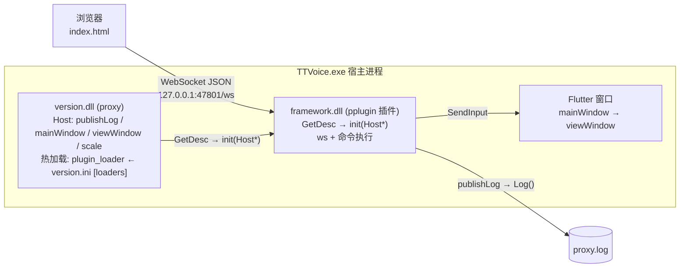

# PlusPlugin 架构（粗粒度）

> 浏览器通过 WebSocket 遥控 TTVoice 宿主窗口。`version.dll`(proxy) 提供宿主能力并热加载插件；`framework.dll` 以 pplugin 插件形式提供 WS 服务端与命令执行。

## 分层图



## ASCII 版

```
浏览器 (index.html)
   │  WebSocket JSON   ws://127.0.0.1:47801/ws
   ▼
┌────────────────────────── TTVoice.exe 宿主进程 ──────────────────────────┐
│ version.dll (proxy)                                                      │
│   Host: publishLog / mainWindow / viewWindow / scale                     │
│   plugin_loader: 读 version.ini [loaders]，逐行 DLL，从 ModuleDir() 加载  │
│        │ GetDesc → init(Host*)                                           │
│        ▼                                                                 │
│ framework.dll (pplugin 插件)                                             │
│   CivetWeb :47801 (/ws) + 命令执行(mouse/key/delay/geometry)             │
│        │ SendInput                                                       │
│        ▼                                                                 │
│ Flutter 窗口 (mainWindow → viewWindow)                                   │
│                                                                          │
│ 日志: [HH:MM:SS.mmm]-[proxy|framework] ...    → proxy.log                │
└──────────────────────────────────────────────────────────────────────────┘
```

## 职责

| 组件 | 提供 |
|---|---|
| **proxy** (`version.dll`) | Host 能力表 `{publishLog, mainWindow, viewWindow, scale}`；热加载（`plugin_loader`，见下） |
| **framework** (`framework.dll`) | pplugin 插件：`ws` 服务端、命令执行（后台）、`publishLog` 回日志 |

## 插件加载 / 热加载

- `version.ini`：
  ```ini
  [loaders]
  framework.dll
  framework2.dll
  ```
- `plugin_loader` 逐行读取，从 `ModuleDir()`（`%APPDATA%\TTVoice`）加载；
- DLL 必须导出 `GetDesc`（`pplugin.h`，`P_ABI v4`），校验 `abi`/`structSize` 后调 `Desc::init(const Host*)`；
- `WatchPlugins()` 每 500ms 比对 DLL 写时间，变化则 卸载 + 重载（热加载）。

## WS 协议

端点：`ws://127.0.0.1:47801/ws`，单帧文本 JSON。

**请求**（`type`=类别，`action`=动作）：
```json
{"id":"1","type":"mouse","action":"click","space":"view","x":400,"y":300,"button":"right"}
{"id":"2","type":"mouse","action":"moveTo","space":"view","x":400,"y":300}
{"id":"3","type":"key","vk":65}
{"id":"4","type":"delay","ms":500}
{"id":"5","type":"geometry"}
{"id":"6","type":"mouse","action":"scroll","delta":-120}
{"id":"7","type":"text","text":"hello 你好"}
{"id":"8","type":"cursor"}
```

**回包**（`{id, success, data, code}`，`0000`=成功 / `9999`=失败）：
```json
{"id":"1","success":true,"data":"","code":"0000"}
{"id":"5","success":true,"data":{"x":862,"y":155,"w":2115,"h":1777,"scale":1.5},"code":"0000"}
{"id":"2","success":false,"data":"moveTo needs x,y","code":"9999"}
{"id":"8","success":true,"data":{"sx":1530,"sy":420,"x":301,"y":210,"lx":200.7,"ly":140,"w":2115,"h":1777,"scale":1.5,"inside":true,"f8":false},"code":"0000"}
```

### 取坐标 / 拾取（picker 模块，见 `framework/picker.cpp`）

取点逻辑在 **framework.dll 内部**（`picker.h` / `picker.cpp`），不在 Python 侧：

- 模块自带一条消息循环线程（`SetTimer` 约 30Hz 采样 + 承载 `WH_MOUSE_LL` 钩子）；
- 广播出口由 `framework.cpp` 用 `mg_websocket_write` 实现（`PickerSend`），
  广播时持锁，连接 close 回调也拿同一把锁摘连接，避免写到已回收的 conn。

命令（客户端 -> 服务端）：

```json
{"id":"1","type":"cursor","action":"watch"}
{"id":"2","type":"cursor","action":"unwatch"}
{"id":"3","type":"pick","action":"start"}
{"id":"4","type":"pick","action":"cancel"}
```

主动推送帧（服务端 -> 客户端，**无 id**，不属任何请求的应答）：

```json
{"t":"cursor","sx":1530,"sy":420,"x":301,"y":210,"lx":200.7,"ly":140,"w":2115,"h":1777,"scale":1.5,"inside":true,"f8":false}
{"t":"pick","action":"ready"}
{"t":"pick","sx":1530,"sy":420,"x":301,"y":210,"lx":200.7,"ly":140,"scale":1.5}
{"t":"pick","action":"cancel"}
{"t":"pick","action":"failed","error":"set hook failed"}
```

- `pick/start`：装钩子，下一次落在应用窗口内的**左键被吞掉**（应用不响应）并回传坐标，
  **右键取消**；任一结果都会自动卸钩子；
- `cursor` 订阅是按连接记的，连接断开或 WS 重连后需重新 `watch`（前端 `cursorStore.js` 已处理），
  收不到推送帧时前端自动退回轮询 `{"type":"cursor"}`。

### 取坐标（只读）

`{"type":"cursor"}`（或 HTTP `GET /api/cursor`）只回报真实光标位置，不注入任何鼠标事件、不装钩子、不吞点击：

- `sx/sy`：屏幕坐标；`x/y`：view 客户区物理像素；`lx/ly`：逻辑坐标（`x/scale`，脚本里存这套）；
- `w/h`：view 客户区尺寸；`scale`：DPI 缩放（与 `/api/app`、`geometry` 同源）；
- `inside`：光标是否落在 view 内；`f8`：宿主进程采样的 F8 键态（页面没焦点时浏览器收不到按键，只能由宿主查全局键态）。

editor2 的「添加/修改事件」弹窗（仅 `mouse` 类型）开着时约 70ms 轮询一次：弹窗内直接显示逻辑/物理/屏幕坐标，鼠标停在目标上按 F8 即捕获并回填 X/Y（不用点按钮、页面无需焦点）；也可以在 X 框粘贴 `"lx, ly"` 一次填两格。

## 日志格式

```
[HH:MM:SS.mmm]-[proxy|framework] <正文>
```
- proxy 侧（`Log`）打 `[proxy]`；插件经 `Host::publishLog` 打 `[framework]`；
- 加载时：`loaders.` + `loader:<dll>.`；写入 `%APPDATA%\TTVoice\proxy.log`。

## 构建 / 部署

```
build.py  ──SSH──► Linux VM ──mingw 静态编译──► version.dll + framework.dll
deploy.py ──拷贝──► %APPDATA%\TTVoice\ (version.dll, framework.dll, index.html) ──► 重启 TTVoice
```
两个 DLL 均为静态自包含（不依赖 `libstdc++/libgcc/libwinpthread`）。
