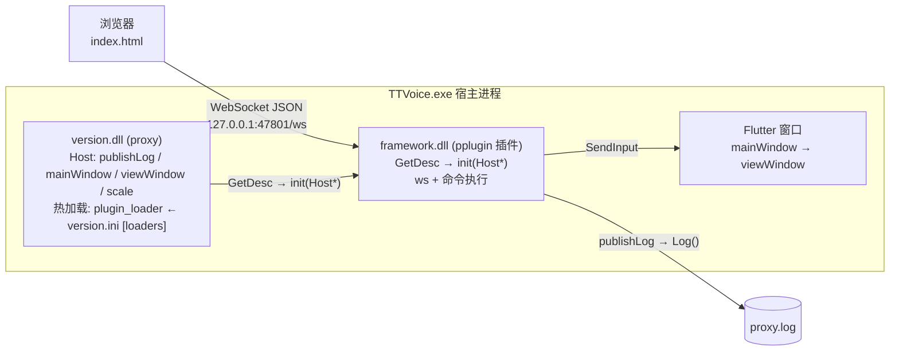

# PlusPlugin 架构（粗粒度）

> 浏览器通过 WebSocket 遥控 TTVoice 宿主窗口。`version.dll`(proxy) 提供宿主能力并热加载插件；`framework.dll` 以 pplugin 插件形式提供 WS 服务端与命令执行。

## 分层图



## ASCII 版

```
浏览器 (index.html)
   │  WebSocket JSON   ws://127.0.0.1:47801/ws
   ▼
┌────────────────────────── TTVoice.exe 宿主进程 ──────────────────────────┐
│ version.dll (proxy)                                                      │
│   Host: publishLog / mainWindow / viewWindow / scale                     │
│   plugin_loader: 读 version.ini [loaders]，逐行 DLL，从 ModuleDir() 加载  │
│        │ GetDesc → init(Host*)                                           │
│        ▼                                                                 │
│ framework.dll (pplugin 插件)                                             │
│   CivetWeb :47801 (/ws) + 命令执行(mouse/key/delay/geometry)             │
│        │ SendInput                                                       │
│        ▼                                                                 │
│ Flutter 窗口 (mainWindow → viewWindow)                                   │
│                                                                          │
│ 日志: [HH:MM:SS.mmm]-[proxy|framework] ...    → proxy.log                │
└──────────────────────────────────────────────────────────────────────────┘
```

## 职责

| 组件 | 提供 |
|---|---|
| **proxy** (`version.dll`) | Host 能力表 `{publishLog, mainWindow, viewWindow, scale}`；热加载（`plugin_loader`，见下） |
| **framework** (`framework.dll`) | pplugin 插件：`ws` 服务端、命令执行（后台）、`publishLog` 回日志 |

## 插件加载 / 热加载

- `version.ini`：
  ```ini
  [loaders]
  framework.dll
  framework2.dll
  ```
- `plugin_loader` 逐行读取，从 `ModuleDir()`（`%APPDATA%\TTVoice`）加载；
- DLL 必须导出 `GetDesc`（`pplugin.h`，`P_ABI v4`），校验 `abi`/`structSize` 后调 `Desc::init(const Host*)`；
- `WatchPlugins()` 每 500ms 比对 DLL 写时间，变化则 卸载 + 重载（热加载）。

## WS 协议

端点：`ws://127.0.0.1:47801/ws`，单帧文本 JSON。

**请求**（`type`=类别，`action`=动作）：
```json
{"id":"1","type":"mouse","action":"click","space":"view","x":400,"y":300,"button":"right"}
{"id":"2","type":"mouse","action":"moveTo","space":"view","x":400,"y":300}
{"id":"3","type":"key","vk":65}
{"id":"4","type":"delay","ms":500}
{"id":"5","type":"geometry"}
{"id":"6","type":"mouse","action":"scroll","delta":-120}
{"id":"7","type":"text","text":"hello 你好"}
```

**回包**（`{id, success, data, code}`，`0000`=成功 / `9999`=失败）：
```json
{"id":"1","success":true,"data":"","code":"0000"}
{"id":"5","success":true,"data":{"x":862,"y":155,"w":2115,"h":1777,"scale":1.5},"code":"0000"}
{"id":"2","success":false,"data":"moveTo needs x,y","code":"9999"}
```

## 日志格式

```
[HH:MM:SS.mmm]-[proxy|framework] <正文>
```
- proxy 侧（`Log`）打 `[proxy]`；插件经 `Host::publishLog` 打 `[framework]`；
- 加载时：`loaders.` + `loader:<dll>.`；写入 `%APPDATA%\TTVoice\proxy.log`。

## 构建 / 部署

```
build.py  ──SSH──► Linux VM ──mingw 静态编译──► version.dll + framework.dll
deploy.py ──拷贝──► %APPDATA%\TTVoice\ (version.dll, framework.dll, index.html) ──► 重启 TTVoice
```
两个 DLL 均为静态自包含（不依赖 `libstdc++/libgcc/libwinpthread`）。
