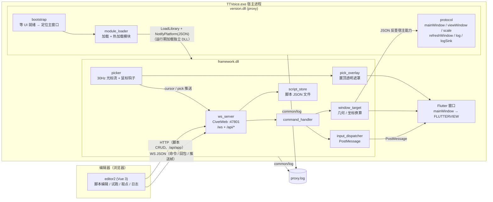

# PlusPlugin 架构（粗粒度）

> 浏览器里的 **editor2** 通过 WebSocket 发输入命令、通过 HTTP 管理脚本；`version.dll`(proxy) 提供宿主能力并直接加载 `framework.dll`；`framework.dll` 起 WS/HTTP 服务端、执行输入、管脚本、做取点与遮罩；两者共用 `common/log` 写同一份 `proxy.log`。

## 分层图



## ASCII 版

```
editor2（浏览器；开发用 vite，构建产物 dist 由 framework 托管）
  │  WS JSON  ws://127.0.0.1:47801/ws          HTTP  /api/scripts · /api/app · /api/cursor
  ▼
TTVoice.exe 宿主进程
│
├─ version.dll (proxy)        ← 系统按 exe 目录加载的代理入口
│   ├─ bootstrap     : 等 UI 就绪 → 定位 FLUTTER_RUNNER_WIN32_WINDOW（可见、非最小化、面积最大）
│   ├─ module_loader : 加载核心模块 + version.ini [modules] 额外模块，700ms 轮询热加载
│   └─ protocol      : NotifyGhost → mainWindow / viewWindow / scale / refreshWindow
│                      log（模块 → proxy.log）/ logSink（供额外模块订阅日志）
│
├─ ······· 运行期 LoadLibrary + NotifyPlatform(JSON) 加载，非包含关系 ·······
│
├─ framework.dll              ← 独立 DLL，由 proxy 在运行期加载
│   ├─ ws_server        : CivetWeb :47801（/ws + /api/*，HTTP 缓冲走堆）
│   ├─ command_handler  : mouse / key / text / delay / geometry / cursor / pick
│   ├─ input_dispatcher : PostMessage 到 FLUTTERVIEW（后台，不动真实鼠标）
│   ├─ window_target    : 客户区矩形 / 屏幕↔客户区换算 / 最小化判定
│   ├─ script_store     : %APPDATA%\TTVoice\scripts\*.json（.tmp + 原子替换）
│   ├─ picker           : 30Hz 光标采样 + WH_MOUSE_LL 拾取（左键吞掉、右键取消）
│   └─ pick_overlay     : 盖在 view 上的置顶透明窗口（十字线 + 实时坐标）
│         │ PostMessage                    ▲ 遮罩窗口
│         ▼                                │
└─ Flutter 窗口（mainWindow → FLUTTERVIEW）┘

日志：[HH:MM:SS.mmm]-[proxy|framework] ... → %APPDATA%\TTVoice\proxy.log（common/log，GBK 落盘）
```

> `version.dll` 与 `framework.dll` 是**两个互不包含的独立 DLL**：前者由系统在宿主启动时加载（DLL 代理），后者是它在运行期 `LoadLibrary` 起来的核心模块，二者只在同一进程内通过 JSON 互相调用，不存在嵌套或父子关系。

## 职责

| 组件 | 提供 |
|---|---|
| **editor2** | 脚本 CRUD、事件表格编辑、试跑（逐条 WS）、取点面板、操作日志面板；`vite dev` 走代理，构建产物 `editor2/dist` 由 framework 直接托管 |
| **proxy** (`version.dll`) | 宿主能力表 `{mainWindow, viewWindow, scale, refreshWindow}`；直接 `LoadLibrary(framework.dll)` 并走 `NotifyPlatform` 协议；`version.ini [modules]` 额外模块加载与热加载；日志走 `common/log`（`[proxy]`） |
| **framework** (`framework.dll`) | WS + HTTP 服务端、命令分发与 `PostMessage` 注入、脚本文件读写、光标流与拾取、拾取遮罩；日志走 `common/log`（`[framework]`） |

### framework 内部模块

| 文件 | 职责 |
|---|---|
| `ws_server` | CivetWeb 封装：`/ws` + `/api/scripts`、`/api/app`、`/api/cursor`；控制帧按 opcode 分流；HTTP 请求/响应缓冲全部走堆（栈上 4MB 缓冲曾导致保存脚本时宿主闪退） |
| `command_handler` | 解析 `{id,type,action,...}`，分发到输入/取点/几何，统一回 `{id,success,data,code}` |
| `input_dispatcher` | `PostMessage` 投递鼠标/按键/滚轮/文本，不移动真实鼠标、不抢焦点 |
| `window_target` | 目标窗口（view→main 回退）、客户区矩形、`screen`/`view` 坐标换算、最小化判定、`refreshWindow` 转发 |
| `script_store` | `%APPDATA%\TTVoice\scripts\<name>.json` 的列表/读/写/删；写入走 `.tmp` + `MoveFileEx` 原子替换 |
| `picker` | 一条消息循环线程：`SetTimer` 约 30Hz 采样光标 + 承载 `WH_MOUSE_LL` 钩子；广播时持锁，连接 close 拿同一把锁摘连接 |
| `pick_overlay` | 拾取时盖在 view 上的置顶透明窗口：十字线、10×10 方框、坐标标签、顶部提示；黑底色键透明 + 整窗 92% alpha，鼠标穿透 |

## 模块加载与热加载（`proxy/module_loader`）

“模块”只是一个导出 `NotifyPlatform(const char*, char*, int)` 的 dll，契约全是 JSON：init 里收 `{"cmd":"init","dispatch":"<NotifyGhost 指针>","ctx":"0"}`，之后用 `{"cmd":"mainWindow"|"viewWindow"|"scale"|"refreshWindow"}` 反查宿主能力，退出收 `{"cmd":"shutdown"}`。**没有共享结构体、没有 GetDesc/ABI 校验。**

- `bootstrap` 在宿主 UI 就绪后调 `module_loader::Start(hostContext)`：
  - `framework.dll` 是**核心模块**，总是第一个加载（`protocol::ProtocolStart`，同时绑好 proxy→framework 的转发通道），加载失败要打 WARN；
  - `version.ini [modules]` 里的裸 dll 名是**额外模块**（`protocol::ModuleStart`），可选，缺文件跳过但继续监视。
- 每个模块各有一个 slot，后台线程每 700ms 读它的**文件标识**（卷序列号 + 文件索引 + 大小）；变化且连续两次一致（写完）后：发 `shutdown` → `FreeLibrary`（解除映射）→ 重试 `LoadLibrary` + `init`（10×300ms）→ 删 `<dll>.old`。
- 部署侧配合：`deploy_plugin.py` 用「改名换位」（`framework.dll` → `.old`，新文件放到原名），正好改变文件标识，**部署即热加载**。WS 客户端（`editor2`）用 `reconnecting-websocket` 自动重连，端口 47801 由 CivetWeb 以 `SO_REUSEADDR` 立即重绑。`version.dll` 不能热换，改它必须重启宿主。
- 实测：2026-10-28 连续两次替换 framework.dll 均 `hot reload done`，替换后 WS `geometry`/`cursor` 正常回包。

## pplugin 插件机制（已彻底退役，2026-10-28）

- 删掉了 `version.ini [loaders]`、`proxy/plugin.cpp` 的插件加载器、`plugin/example`、`plugin/script-engine`、`libs/nlohmann`，以及契约头 `common/pplugin.h`（`P_ABI` / `Host` / `Desc` / `GetDesc` 全部不再存在）。
- `plugin/` 下的模块（`plugin/console` 的日志面板、`plugin/script-engine` 等）随后也一并移除，仓库目前只保留核心 `framework.dll`。
- `version.ini [modules]` 的**额外模块加载能力仍然保留**：按 `NotifyPlatform` + JSON 契约自己实现即可（`{"cmd":"log"}` 写 proxy.log、`{"cmd":"logSink","ptr":...}` 订阅日志，由 `proxy/log_relay` 镜像）。首次启用需重启宿主，之后换文件即热加载。

## WS 协议

端点：`ws://127.0.0.1:47801/ws`，单帧文本 JSON。

**请求**（`type`=类别，`action`=动作）：

```json
{"id":"1","type":"mouse","action":"click","space":"view","x":400,"y":300,"button":"right"}
{"id":"2","type":"mouse","action":"moveTo","space":"view","x":400,"y":300}
{"id":"3","type":"key","vk":65}
{"id":"4","type":"delay","ms":500}
{"id":"5","type":"geometry"}
{"id":"6","type":"mouse","action":"scroll","delta":-120}
{"id":"7","type":"text","text":"hello 你好"}
{"id":"8","type":"cursor"}
{"id":"9","type":"pick","action":"start","topmost":true}
```

**回包**（`{id, success, data, code}`，`0000`=成功 / `9999`=失败）：

```json
{"id":"1","success":true,"data":"","code":"0000"}
{"id":"5","success":true,"data":{"x":862,"y":155,"w":2115,"h":1777,"scale":1.5},"code":"0000"}
{"id":"2","success":false,"data":"moveTo needs x,y","code":"9999"}
{"id":"8","success":true,"data":{"sx":1530,"sy":420,"x":301,"y":210,"lx":200.7,"ly":140,"w":2115,"h":1777,"scale":1.5,"inside":true,"f8":false},"code":"0000"}
```

## HTTP 接口

| 方法 | 路径 | 说明 |
|---|---|---|
| `GET` | `/api/scripts` | 列出脚本名数组 |
| `GET` | `/api/scripts?name=X` | 读脚本（`{version,name,loop,events}`，也兼容纯数组） |
| `POST`/`PUT` | `/api/scripts?name=X` | 保存脚本（请求体上限 4MB，节点池 256） |
| `DELETE` | `/api/scripts?name=X` | 删除脚本 |
| `GET` | `/api/app` | 让宿主**重新解析窗口**后返回 `{x,y,w,h,scale,refreshed,app}`；最小化返回 `data:"view window minimized"`，找不到窗口返回 `data:"view window unavailable"` |
| `GET` | `/api/cursor` | 一次性光标读数（与 `{"type":"cursor"}` 同 payload） |

脚本文件落在 `%APPDATA%\TTVoice\scripts\<name>.json`，编辑器试跑直接读同一份文件。

### 取坐标 / 拾取（`picker` + `pick_overlay`）

取点逻辑在 **framework.dll 内部**，不在 Python 侧：

- `picker` 自带一条消息循环线程（`SetTimer` 约 30Hz 采样 + 承载 `WH_MOUSE_LL` 钩子）；
- 广播出口由 `framework.cpp` 用 `mg_websocket_write` 实现（`PickerSend`），广播时持锁，连接 close 回调也拿同一把锁摘连接，避免写到已回收的 conn。
- `pick_overlay` 是拾取期间的遮罩：`WS_EX_LAYERED|TRANSPARENT|TOPMOST|TOOLWINDOW|NOACTIVATE`，纯黑做色键（全透明，底下界面照样可见）+ 整窗 92% alpha；画窗口边框、跟随光标的十字线/方框、`逻辑 (lx, ly)   物理 (px, py)` 标签、顶部 `左键拾取　右键取消`。目标窗口最小化时挂起不显示，恢复后下个 tick 自动出现；每帧把自己提回 topmost 最前，避免被"拾取时置顶"的目标窗口压住。

命令（客户端 -> 服务端）：

```json
{"id":"1","type":"cursor","action":"watch"}
{"id":"2","type":"cursor","action":"unwatch"}
{"id":"3","type":"pick","action":"start","topmost":true}
{"id":"4","type":"pick","action":"cancel"}
```

主动推送帧（服务端 -> 客户端，**无 id**，不属任何请求的应答）：

```json
{"t":"cursor","sx":1530,"sy":420,"x":301,"y":210,"lx":200.7,"ly":140,"w":2115,"h":1777,"scale":1.5,"inside":true,"f8":false}
{"t":"pick","action":"ready"}
{"t":"pick","sx":1530,"sy":420,"x":301,"y":210,"lx":200.7,"ly":140,"scale":1.5}
{"t":"pick","action":"cancel"}
{"t":"pick","action":"failed","error":"set hook failed"}
```

- `pick/start`：装钩子，下一次落在应用窗口内的**左键被吞掉**（应用不响应）并回传坐标，**右键取消**；任一结果都会自动卸钩子；
- `topmost:true` 时先把目标窗口的顶层窗口 `SW_RESTORE`（若最小化）+ `HWND_TOPMOST`，拾取结束（取到点 / 取消）再按原状态还原，编辑器的"拾取时置顶"就是这个开关；
- `cursor` 订阅是按连接记的，连接断开或 WS 重连后需重新 `watch`（前端 `cursorStore.js` 已处理），收不到推送帧时前端自动退回轮询 `{"type":"cursor"}`。

### 取坐标（只读）

`{"type":"cursor"}`（或 HTTP `GET /api/cursor`）只回报真实光标位置，不注入任何鼠标事件、不装钩子、不吞点击：

- `sx/sy`：屏幕坐标；`x/y`：view 客户区物理像素；`lx/ly`：逻辑坐标（`x/scale`，脚本里存的这套）；
- `w/h`：view 客户区尺寸；`scale`：DPI 缩放（与 `/api/app`、`geometry` 同源）；
- `inside`：光标是否落在 view 内；`f8`：宿主进程采样的 F8 键态（页面没焦点时浏览器收不到按键，只能由宿主查全局键态）。

editor2 的「添加/修改事件」弹窗（仅 `mouse` 类型）开着时约 70ms 轮询一次：鼠标停在目标上按 F8 即捕获并回填 X/Y（不用点按钮、页面无需焦点），也可以在 X 框粘贴 `"lx, ly"` 一次填两格；要看得见的实时坐标就点「左键拾取」，坐标由宿主侧的遮罩窗口画在目标窗口上。

## 刷新应用（`refreshWindow`）

`GET /api/app` 每次都先让 proxy 重新解析窗口，所以编辑器点「刷新应用」能自愈"窗口重建后句柄失效"：

- proxy 只在 `mainWindow`/`viewWindow` 已失效（`IsWindow` 为假）时才重新枚举，窗口最小化时**不**改指令别的 Flutter 窗口（应用常同时开着图片查看器等）；
- 启动时的主窗口选取规则：同进程、可见、非最小化、**面积最大**的 `FLUTTER_RUNNER_WIN32_WINDOW`；
- framework 侧 `HostCaps` 有第 4 根指针 `refreshWindow`，旧宿主没有也不会崩（返回 `nullptr` → 刷新被跳过）。

## 日志格式

```
[HH:MM:SS.mmm]-[proxy|framework] <正文>
```

- proxy 与 framework 共用 `common/log` 模块，分别打 `[proxy]` / `[framework]`，写入同一 `%APPDATA%\TTVoice\proxy.log`；
- 落盘编码是**本地 ANSI(GBK)**（源字面量仍是 UTF-8，`LogV` 里转一次），用记事本打开不乱码；
- 加载握手时 proxy 还会打 `module:` / `protocol:` 等前缀；framework 不再经 `publishLog` 回写（已去掉订阅/发布往返）；
- editor2 另有一份**内存操作日志**（`logStore.js`，最多 500 行，不落盘）：每个按钮/弹窗操作、WS 连接状态、脚本增删改、试跑每一步都留一条。

## 构建 / 部署

```
scripts/framework_build.py  ──SSH──► Linux VM ──mingw 静态编译──► framework/framework.dll
scripts/proxy_build.py      ──SSH──► Linux VM ──mingw 静态编译──► proxy/version.dll
deploy.py           ──拷贝──► %APPDATA%\TTVoice\version.dll ──► 重启 TTVoice
deploy_plugin.py    ──拷贝──► %APPDATA%\TTVoice\framework.dll + editor2/dist ──► 热加载
```

两个 DLL 均为静态自包含（不依赖 `libstdc++/libgcc/libwinpthread`）。`framework.dll` 与额外模块换文件即热加载；`version.dll` 必须重启宿主。
