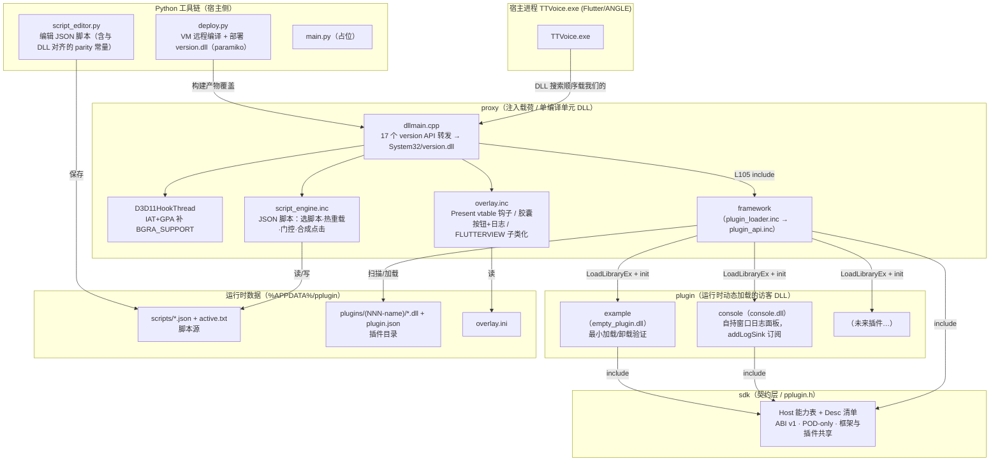

# PlusPlugin 项目架构图

> 按**项目包**划分的架构说明，基于当前源码事实（非计划）。
> 对应源码：`proxy/`、`framework/`、`sdk/`、`plugin/`、`../script_editor.py`、`deploy.py`。

## 架构图

## 各包职责与依赖（对照实际文件）

| 包 | 路径 | 角色 | 关键依赖 |
|---|---|---|---|
| **proxy** | `proxy/` | 注入载荷本体：`dllmain.cpp` + `overlay.inc` + `script_engine.inc`，单编译单元 | 编译期 include framework |
| **framework** | `framework/plugin_api.inc`、`plugin_loader.inc` | 插件系统**宿主侧**：实现 `Host` 能力表、扫描/校验/加载/卸载/派发/control.txt | include `sdk/pplugin.h` |
| **sdk** | `sdk/pplugin.h` | **ABI 契约**：`Host`（log/draw/region/hotkey/task/query/logsink）+ `Desc`（init/tick/shutdown），ABI v1 | 无，纯契约 |
| **plugin** | `plugin/console/`、`plugin/example/` | **访客 DLL**：只见到 `Host` 表，经 `GetDesc` 导出，运行时被加载 | include `sdk/pplugin.h` |
| **Python 工具链** | `../script_editor.py`、`deploy.py`、`main.py` | 运维侧：脚本编辑器（与 DLL 的 parity 常量对齐）、远程编译部署、占位入口 | 文件/网络，不直接进进程 |

## 关键架构事实（已核对源码）

- 编译耦合：`dllmain.cpp` **L105** `#include "framework/plugin_loader.inc"`，后者拉 `plugin_api.inc` 与 `sdk/pplugin.h`，所以 framework + sdk 都被静态编进 `version.dll` 一个产物。
- 运行解耦：插件 DLL **不在编译期链接**，由 framework 在 `plugins\` 目录扫描，校验 x64 PE / ABI / 导出 `GetDesc` 后 `LoadLibraryEx` 加载，`init(&g_host)` 拿到能力表。
- 控制面：framework 单 loader 线程跑 `tick`(16ms) / `task` 派发 / `control.txt` 轮询（load/unload/list）；插件不拥有线程、不装钩子、不碰系统注册点（所有权归 framework，卸载可统一吊销）。
- 数据隔离：脚本走 `scripts\`，插件走 `plugins\`，二者互不相关，都由 `%APPDATA%\pplugin` 下的文件驱动。
