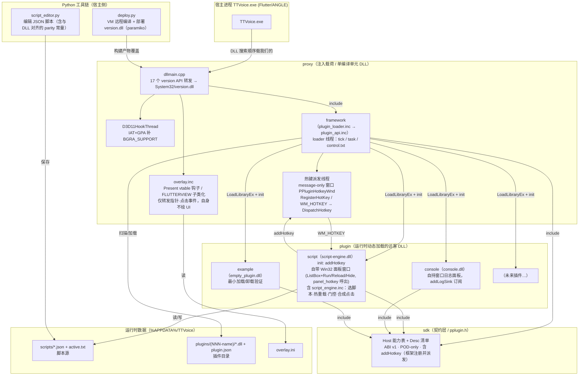
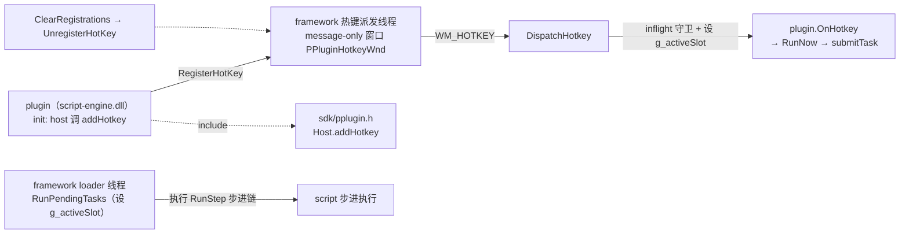

# PlusPlugin 项目架构图 2（Phase 3：脚本插件自持 + 框架收敛后）

> 与 `docs/架构图.md`（改动前）对照阅读；本图基于 Phase 1 / Phase 2 / Phase 3 全部落地后的源码事实。
> 对应源码：`proxy/`、`framework/`、`sdk/`、`plugin/`、`../script_editor.py`、`deploy.py`。

## 架构图（更新后）

## 相对 `架构图.md` 的变更点

| 维度 | 原架构（架构图.md） | 现架构（本图，Phase 1） |
|---|---|---|
| 热键注册 | `script_engine.inc` 自起线程 `RegisterHotKey(nullptr, 0x5454, …)` | **框架** `HostAddHotkey` → `RegisterHotKey(g_hotkeyHwnd, id, 0, vk)` |
| 热键派发 | 框架引擎收到 `WM_HOTKEY` 后直接 `ScriptRun()` | `DispatchHotkey(id)` → 命中插件 `HotkeyEntry` → `fn(vk, user)`（`OnHotkey`） |
| 收消息载体 | `nullptr` hwnd → 注册线程自己的队列 | **message-only 窗口** `PPluginHotkeyWnd` + 专用线程 pump |
| 插件取键 | `GetAsyncKeyState` 在 tick 里轮询 | 删除轮询；`init` 里 `addHotkey` 注册 |
| 卸载 | 不注销 | `ClearRegistrations` 逐个 `UnregisterHotKey` |
| 回调上下文 | `g_activeSlot` 全局，只在 init/shutdown 设 | `g_activeSlot` 改 **`thread_local`**；tick / task / hotkey 回调都设上下文 |
| 线程数 | 单 loader 线程 | loader 线程 + **热键派发线程**（两个常驻线程） |
| 运行时目录 | 正文写 `%APPDATA%/pplugin`（误改） | 实际功能路径为 **`%APPDATA%\TTVoice`** |

## 更新后的热键链路（局部）

## 关键架构事实（Phase 1 后，已核对源码）

- framework 现在有**两个**常驻线程：loader 线程（`tick` 16ms / `task` 派发 / `control.txt` 轮询）+ **热键派发线程**（消息-only 窗口，专门 pump `WM_HOTKEY`）。
- `RegisterHotKey(hwnd, …)` 的 `WM_HOTKEY` 只会投递到**创建该 hwnd 的线程**，因此必须由专用线程 pump；loader 线程不碰消息循环。
- 热键 id 由框架分配：`kHotkeyIdBase + slot * MAX_HOTKEYS + index`，`WM_HOTKEY.wParam` 即 id，`DispatchHotkey` 据此找到插件条目。
- `g_activeSlot` 为 `thread_local`：loader 线程（init / shutdown / tick / task）与热键线程（dispatch）各自拥有上下文，插件在这些回调里调用 `Host::log` / `submitTask` 都能正确归属本插件。
- 插件不再自行 `RegisterHotKey` / `GetAsyncKeyState`；热键注册与派发全部归 framework，卸载时统一 `UnregisterHotKey`，不会泄漏。
- 运行时目录实际是 `%APPDATA%\TTVoice`（`kPluginsRootFormat`、`deploy.py` 使用）；文档里出现的 `%APPDATA%/pplugin` 为品牌清理时的笔误。
- 新派发器只在**重新部署 `version.dll`** 后生效；旧 `version.dll` 无此代码，`addHotkey` 只会被"记账"。

## 后续（当前状态）

- [x] `render.inc` 的 draw / click / pointer 分发前设置 `g_activeSlot`，与 tick/task/hotkey 一致（已落地）。
- [x] Phase 2：`script-engine.dll` 自带 Win32 面板窗口（ListBox 选脚本 + Run/Reload/Hide，热键 `panel_hotkey` 呼出）；运行请求经 `tick` 转发（面板线程无 slot 上下文，不能直调 `submitTask`）。
- [x] Phase 3：`overlay.inc` 移除自绘胶囊/屏上日志与 `HitTest`/pill 逻辑，仅 `DispatchPointer`/`DispatchClick`；`script_engine.inc` 移入 `plugin/script-engine/`，`build_plugin.py script` 的 deps 由 `("sdk","proxy")` 改为 `("sdk",)`；`overlay.inc` 的 gating 死代码（`CaptureView`/`CountCreamBand`/`ViewCapture`/`g_capture`/`PW_RENDERFULLCONTENT`）已清理。
- [x] 部署：新 `version.dll` 已通过 `deploy.py`（`taskkill TTVoice.exe` 后覆盖并重启）上线，TTVoice 已正常运行。
