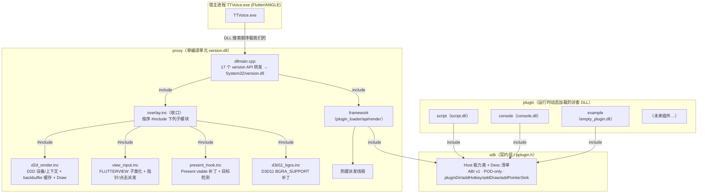
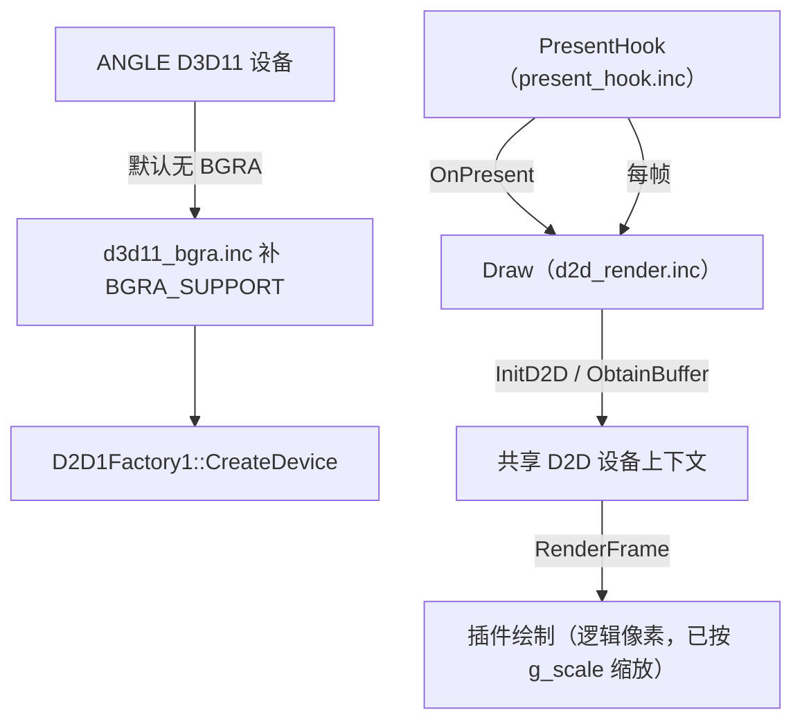
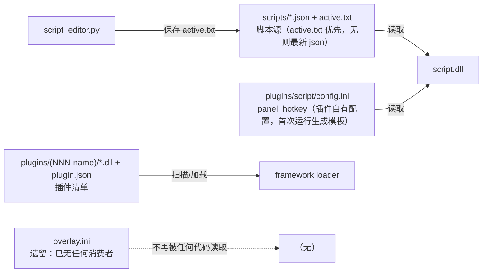

# PlusPlugin 项目架构图 3（Phase 3 收尾 + overlay 按职责拆分后）

> 与 `docs/架构图2.md`（上一版）对照阅读；本图基于当前源码事实。
> 对应源码：`proxy/`（含 `overlay.inc` 与其子模块 `d2d_render.inc`/`view_input.inc`/`present_hook.inc`/`d3d11_bgra.inc`）、`framework/`、`sdk/`、`plugin/`、`script_editor.py`、`deploy.py`。

> 本版把原来的一张大图拆成 5 张小图，每张只讲一件事：①模块总览 ②线程与消息 ③插件生命周期 ④渲染链路 ⑤数据与配置。

---

## ① 模块总览



## ② 线程与消息

```mermaid
graph TB
    subgraph "常驻线程（version.dll）"
        LOADER["loader 线程<br/>tick 16ms / task 派发 / control.txt 轮询"]
        HOTKEY["热键派发线程<br/>message-only 窗口 PPluginHotkeyWnd<br/>RegisterHotKey / WM_HOTKEY"]
        WINDOW["视图线程（Flutter view）<br/>ViewProc 子类化窗口过程"]
        D3D11["D3D11HookThread<br/>DllMain 起，补 BGRA 后退出"]
    end

    subgraph "插件线程"
        PANEL["script 面板线程<br/>ListBox + Run/Reload/Hide"]
    end

    SCRIPT_PLUGIN["script.dll"]

    LOADER -->|tick()| SCRIPT_PLUGIN
    HOTKEY -->|WM_HOTKEY| SCRIPT_PLUGIN
    WINDOW -->|DispatchPointer/DispatchClick| SCRIPT_PLUGIN
    SCRIPT_PLUGIN -->|addHotkey| HOTKEY
    PANEL -->|g_runRequested → 经 tick 转发| SCRIPT_PLUGIN
    D3D11 -.->|必须早于 ANGLE 建 D3D11 设备| EXE["TTVoice.exe"]
```

## ③ 插件生命周期

```mermaid
graph LR
    FRAME["framework loader"] -->|扫描 plugins/| DISCOVER["发现 (NNN-name)/ + plugin.json"]
    DISCOVER -->|LoadLibraryEx（受限搜索）| LOAD["加载 DLL"]
    LOAD -->|GetProcAddress 取 GetDesc| DESC["取 Desc（名字/版本/ABI）"]
    DESC -->|核对 ABI v1| VERIFY["校验"]
    VERIFY -->|host->init| INIT["init() 注册 hotkey/draw/pointer"]
    INIT --> RUN["运行中：tick/task/draw/pointer/click"]
    RUN -->|host->shutdown| SHUT["shutdown()"]
    SHUT -->|FreeLibrary| UNLOAD["卸载（无悬空 hook）"]
```



## ④ 渲染链路



## ⑤ 数据与配置



---

## 相对 `架构图2.md` 的变更点

| 维度 | 架构图2（上一版） | 本图（当前） |
|---|---|---|
| 脚本选择 | `overlay.ini script=` > `active.txt` > 最新 json | **`active.txt` > 最新 json**；`script=` 已删除，指定脚本改由面板 Run |
| 门控间隔 | `overlay.ini gate_poll_ms`（ini 键） | **编译期常量 120ms**（`script_plugin.cpp::g_gatePollMs`） |
| 面板热键 | `overlay.ini panel_hotkey` | **`plugins\script\config.ini panel_hotkey`**（插件自有配置，首次运行自动生成模板） |
| `overlay.ini` | 框架 + 插件都读 | **已无消费者**（框架 `LoadConfig` 删除、插件改用 config.ini），仅遗留文件 |
| 框架自绘 UI | 无（但残留字体/颜色/`LoadConfig` 死代码） | **死代码已全部删除** |
| D3D11 hook | 内联在 `overlay.inc` | **抽到 `proxy/d3d11_bgra.inc`** |
| `overlay.inc` 结构 | 单文件承载全部逻辑 | **按职责拆成 `d2d_render.inc` / `view_input.inc` / `present_hook.inc` + 收口 `overlay.inc`**（均单编译单元、`namespace ov` 内 include） |

## D3D11 BGRA hook 为什么是框架代码、不能做成插件

- **时机**：`StartD3D11Hook()` 在 `DllMain`（`DLL_PROCESS_ATTACH`）里就起线程，必须早于 ANGLE 建 D3D11 设备；插件要等主窗口出现（`PayloadThread` 等 `FLUTTERVIEW`）后才加载，那时设备早已创建，补 `BGRA_SUPPORT` 已晚。
- **契约**：`sdk/pplugin.h` 规则 3 明确“插件不得自行装 hook / 建线程 / 碰系统注册点”。
- **卸载安全**：IAT/GPA patch 的指针指向本模块地址，插件 `FreeLibrary` 后即悬空；hook 必须住在常驻的 `version.dll` 里。

## 关键架构事实（当前，已核对源码）

- framework 两个常驻线程：loader 线程（`tick` 16ms / `task` 派发 / `control.txt` 轮询）+ 热键派发线程（message-only 窗口 pump `WM_HOTKEY`）。
- `g_activeSlot` 为 `thread_local`；draw / click / pointer / tick / task / hotkey 回调都设上下文，插件内 `Host::log` / `submitTask` 归属正确。
- 插件不注册热键、不装 hook、不建线程；热键注册/派发与卸载注销全归 framework。
- 渲染：`overlay.inc` 拆出的 `d2d_render.inc` 只保留 D2D 设备/上下文与 `Draw`，`present_hook.inc` 负责 Present vtable 补丁与每帧 `OnPresent`，`view_input.inc` 负责视图子类化与输入派发；自身不画任何 UI。
- 脚本插件配置独立：`plugins\script\config.ini`（`panel_hotkey`），`install()` 只覆盖 `script.dll`/`plugin.json`，配置长期保留。
- 运行时数据根目录为 `%APPDATA%\TTVoice`。

## 当前状态

- [x] Phase 1：热键注册/派发归 framework；`g_activeSlot` 上下文补齐。
- [x] Phase 2：`script.dll` 自带 Win32 面板窗口（ListBox + Run/Reload/Hide）。
- [x] Phase 3：`overlay.inc` 不再自绘任何 UI；`script_engine.inc` 移入插件；debt/死代码清理完毕。
- [x] 配置归位：`script=` 删除、`gate_poll_ms` 固定、`panel_hotkey` 迁入插件 `config.ini`。
- [x] `D3D11HookThread` 抽为 `proxy/d3d11_bgra.inc`。
- [x] `overlay.inc` 按职责拆为 `d2d_render.inc` / `view_input.inc` / `present_hook.inc` + 收口 `overlay.inc`。
- [ ] 部署：`version.dll` 最新构建（含上述改动）仍需 `deploy.py` 部署后生效。
