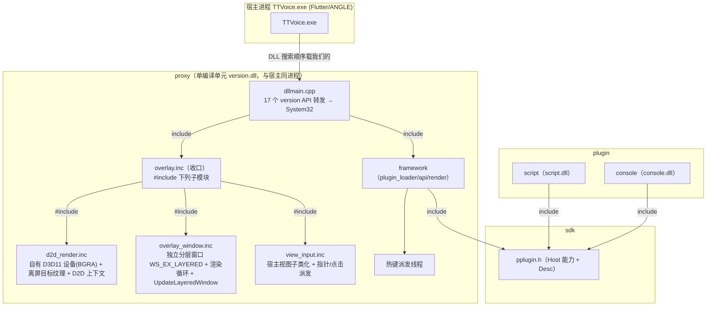
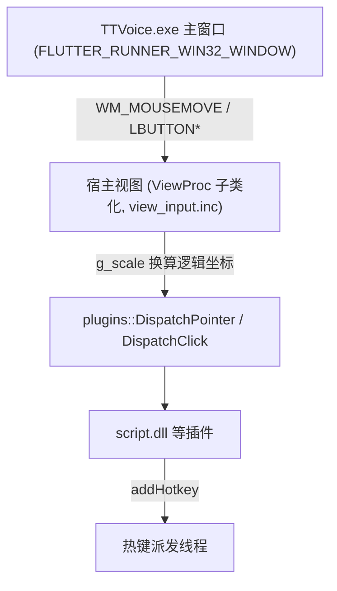

# PlusPlugin 项目架构图 4（方案 A：独立分层 overlay 窗口，同进程）

> 在 `docs/架构图3.md`（按职责拆成 d2d_render / view_input / present_hook + d3d11_bgra）基础上，把渲染模型从
> “hook 宿主 Present、画进宿主 backbuffer” 改为 “框架自建独立分层窗口（同进程），自有 D3D11 设备，经
> UpdateLayeredWindow 合成”。本图只描述方案 A，旧模型见架构图3。
> 对应源码：`proxy/overlay.inc`（收口）、`d2d_render.inc`、`overlay_window.inc`、`view_input.inc`、以及 `dllmain.cpp`。

> 本版图小、每张只讲一件事：①模块总览 ②渲染与合成链路 ③输入链路。

---

## ① 模块总览



> 与架构图3 的关键差异：`present_hook.inc`（Present vtable 补丁）与 `d3d11_bgra.inc`（BGRA hook）
> 在方案 A 中**已删除**——不再需要 hook 宿主、也不再需要给 ANGLE 设备补 BGRA。

## ② 渲染与合成链路（方案 A 核心）

```mermaid
graph TB
    OWN["自有 D3D11 设备<br/>D3D11CreateDevice(BGRA_SUPPORT)"] -->|创建离屏纹理| TEX["targetTex (DEFAULT, RENDER_TARGET)"]
    TEX -->|CreateBitmapFromDxgiSurface| BMP["D2D 位图目标"]
    LOOP["overlay_window 渲染循环 (SetTimer 16ms)"] -->|RenderInto| DRAW["g_d2dCtx->BeginDraw + RenderFrame(插件) + EndDraw"]
    DRAW --> TEX
    TEX -->|CopyResource| STAGE["stagingTex (STAGING, CPU_READ)"]
    STAGE -->|Map 回读(翻转成 bottom-up DIB)| DIB["32bpp ARGB DIB (g_ovBits)"]
    DIB -->|UpdateLayeredWindow (AC_SRC_ALPHA)| LAYER["分层窗口 (透明穿透)"]
    LAYER -->|DWM 合成| DESKTOP["桌面 / 宿主窗口之上"]
```

- 插件仍通过 `plugins::RenderFrame(ID2D1DeviceContext*, w, h)` 画到**框架提供的 D2D 上下文**；框架不画任何 UI，只提供画布。
- 窗口 `WS_EX_TRANSPARENT`：鼠标穿透，输入不归 overlay 窗口，仍走宿主视图子类（见③）。
- `WS_EX_TOPMOST` + 每帧 `FollowHost()` 把窗口贴到宿主客户区并跟随移动/缩放。

## ③ 输入链路（与旧模型一致）



- 输入与渲染解耦：渲染在 overlay 自己的窗口/线程里，输入仍由**宿主视图子类**捕获后派发给插件。
- 宿主视图子类化在 `Init` 里调用 `EnsureViewSubclass(g_hwnd)` 完成；`g_hwnd` 是 `PayloadThread` 找到的 Flutter 主窗口。

---

## 相对架构图3 的变更点

| 维度 | 架构图3（旧模型） | 本图（方案 A） |
|---|---|---|
| 渲染位置 | 画进**宿主 backbuffer**（hook Present 拿到每帧时机） | 画进**独立分层窗口**（自有窗口 + 自有 D3D11 设备） |
| Present 钩子 | `present_hook.inc`：vtable 补丁 Present/Present1/ResizeBuffers | **删除**（不再借宿主帧时机） |
| D3D11 BGRA hook | `d3d11_bgra.inc`：给 ANGLE 设备补 BGRA_SUPPORT | **删除**（自有设备建时就带 `BGRA_SUPPORT`） |
| 每帧时机 | 宿主每 `Present` 一次 → `OnPresent` | overlay 窗口自己的 `SetTimer(16ms)` 渲染循环 |
| 合成方式 | D2D 位图目标绑到宿主 backbuffer | 离屏纹理 → 回读 DIB → `UpdateLayeredWindow`（DWM 合成） |
| 与宿主关系 | 同进程（DLL 注入），但画在宿主帧缓冲里 | 同进程，**独立 HWND** 浮在宿主之上（透明穿透） |
| 输入 | 宿主视图子类（不变） | 宿主视图子类（不变） |

## 方案 A 的取舍

- **利**：彻底移除 vtable 补丁 / IAT 补丁 / flip-model 缓冲缓存 / ResizeBuffers 处理等脆弱代码；overlay 崩溃更难污染宿主 swap chain；不再依赖 ANGLE 内部时序。
- **弊**：需跟随宿主窗口位置/尺寸/DPI；不再与宿主帧逐帧锁相，靠 DWM 合成（桌面 app 通常无感）；`UpdateLayeredWindow` 的 DIB 回读比直接画 backbuffer 多一次拷贝。
- **注意**：输入子类的目标是 `PayloadThread` 找到的 Flutter 主窗口（`g_hwnd`）。若实际输入落在某个子视图（如 `FLUTTERVIEW`）上导致收不到，需改为枚举并子类化子视图——这一点需部署后实测确认。

## 当前状态

- [x] 新分支 `feat/overlay-layered-window` 已建（基于 `master-plugin`）。
- [x] 删除 `present_hook.inc`、`d3d11_bgra.inc`；`dllmain.cpp` 移除 `StartD3D11Hook` 调用。
- [x] 新增 `overlay_window.inc`；`d2d_render.inc` 改为自有设备 + 离屏纹理 + 回读。
- [x] `overlay.inc` 收口为“建独立窗口 + 渲染循环”，输入仍走 `view_input.inc`。
- [x] `build.py` 构建 `[OK]`（仅原有 `plugin_loader.inc(881)` 警告）。
- [ ] **运行时验证**：当前环境无法可视化测试，需 `deploy.py` 部署到 TTVoice 后肉眼确认 overlay 显示、透明、跟随窗口、输入正常。
