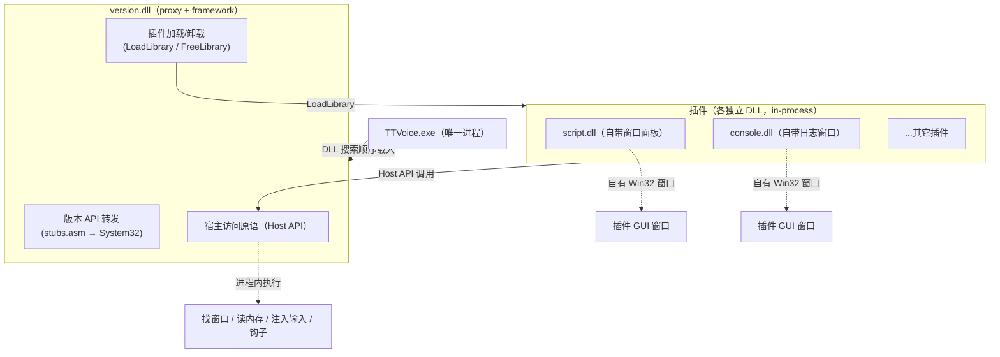
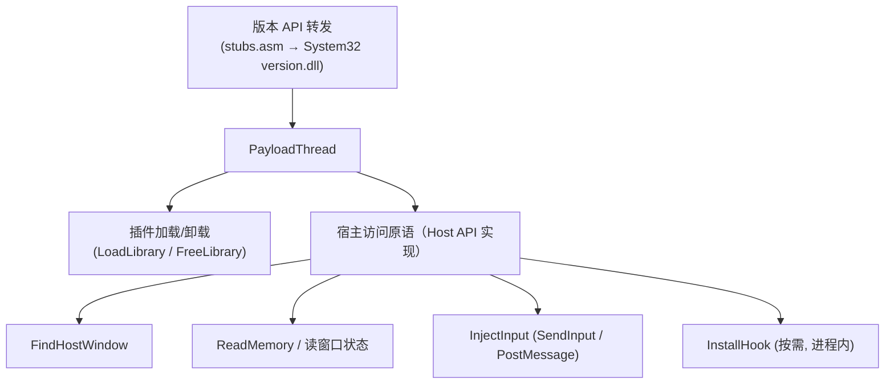
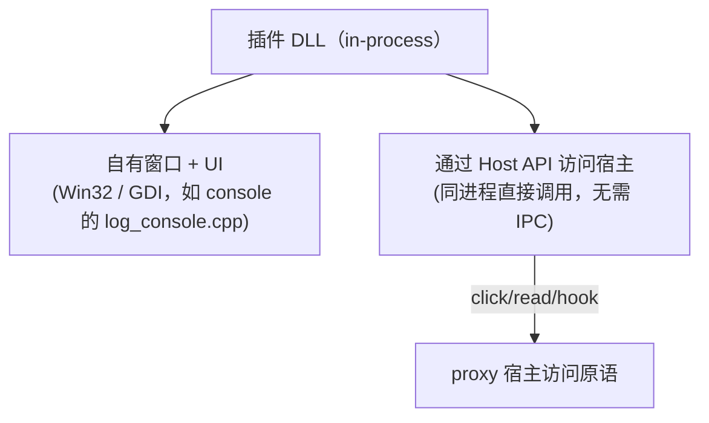
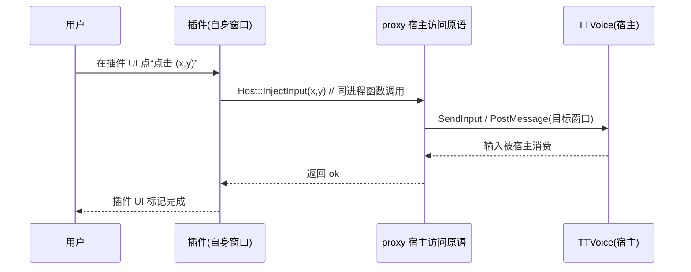

# PlusPlugin 项目架构图 5（方向：插件自带 GUI 窗口，proxy 不绘图、无独立 APP）

> 修正版：上一份草稿误画成“独立 PlusPluginApp + IPC”。按澄清，**GUI 属于插件自身，没有独立 APP**。
> 插件是 in-process 的**独立 DLL 模块**：由 `version.dll` 内的 framework 通过 LoadLibrary 加载、与 `version.dll` 同处宿主进程，但**并非 `version.dll` 的一部分**（console/script 各自在宿主进程里开自己的窗口），
> 因此**不需要 IPC**——插件直接用 framework 的 Host API 访问宿主即可。
> proxy 只做版本转发 + 宿主访问原语 + 插件加载，**完全不碰图形**，故旧模型的黑屏/重启 bug 结构性消失。
> 对应源码：`proxy/dllmain.cpp` 负责在宿主进程找到窗口并把句柄交给框架；host 访问原语（含 DPI `scale` 计算）实现于 `framework/plugin_api.inc`（`ComputeHostScale` / `SetHostContext` / `HostScale`）。插件各带自己窗口（如 `plugin/console`）。

> 本版图小、每张只讲一件事：①总体 ②proxy 职责 ③插件职责 ④典型时序 ⑤与旧方案对比。

---

## ① 总体架构（单进程）

> 没有第二个进程，没有中心 overlay。每个插件的 GUI 是它**自己的窗口**，浮在桌面上（或作为普通窗口）。

## ② proxy 职责（薄 host-agent，零图形）

- **不再包含**：`d2d_render.inc` / `overlay_window.inc` / `view_input.inc` / `present_hook.inc` / `d3d11_bgra.inc` / `framework/render.inc`（RenderFrame 的 D2D 绘制不再需要）。
- **不再链接**：`d2d1.lib` / `d3d11.lib` / `dxgi.lib` / `gdi32.lib`（按需保留 user32 等）。
- proxy 不再 hook Present / 不再建任何 D3D 设备 → 无 device-loss / TDR / 重启风险。

## ③ 插件职责（自带 GUI + 直接访问宿主）

- 插件想显示什么，就在**自己的窗口**里画（GDI/普通窗口即可，不碰宿主 swap chain）。
- 想操作宿主，调 `Host::*` 原语——因为同进程，调用即生效。

## ④ 典型时序：插件注入一次点击

> 注意：这里没有 IPC 步骤——插件与 proxy 同属一个进程，调用即达。

---

## 与现有方案对比

| 维度 | 旧模型（present-hook） | 方案 A（架构图4，分层窗口） | 本方案（架构图5，插件自带窗口） |
|---|---|---|---|
| proxy 是否绘图 | 是（画进宿主 backbuffer） | 是（自有分层窗口） | **否（零图形）** |
| 是否触碰宿主 swap chain | 是（hook Present） | 否 | 否 |
| 独立 APP 进程 | 无 | 无 | **无** |
| 是否需要 IPC | 否 | 否 | **否** |
| GUI 归属 | framework 画（已删死 UI） | framework overlay | **各插件自带窗口** |
| 黑屏/重启风险 | 高（已踩） | 低 | **无（无设备）** |
| 进程隔离 | 同进程 | 同进程 | 同进程（插件窗口独立 HWND） |

## 关键事实与待确认

- [x] 插件本就是 in-process 加载（console/script 已自开窗口），故本方案**无需 IPC、无需独立 APP**。
- [x] proxy 不建任何 D3D 设备 → 结构上不可能再出现黑屏/重启类 bug。
- [x] **代码已落地**（分支 `feat/plugin-owned-gui`）：删除 `d2d_render.inc` / `overlay_window.inc` / `view_input.inc` / `framework/render.inc`，以及 `proxy/host.inc`（其 DPI scale 计算已并入 framework 的 `ComputeHostScale`/`SetHostContext`）；`dllmain.cpp` 仅负责找窗口并调用 `plugins::SetHostContext(hwnd)`，`Host::scale()` 的数据源完全在 framework 内。proxy 内已无任何 D3D/DXGI/D2D 代码。
- [x] **编译验证已通过**（构建 VM `172.20.106.42` 可达：`build.py` 编译 `version.dll` [OK]，并 `build_plugin.py` 重编 console/script 插件；`deploy.py` 部署后真机启动正常、`host init=1 scale=1.50`、插件加载成功、无崩溃）。proxy/framework 内已无残留 `RenderFrame`/`DispatchClick`/已删 `.inc`/`EnsureViewSubclass`/`host.inc`/`QueryDpi` 等符号。
- [ ] 待确认：是否保留 `feat/overlay-layered-window`（方案 A）分支，还是直接在此基础上继续。
- [ ] 待确认：插件 UI 用纯 Win32/GDI（最简），还是统一一套轻量 UI 封装供插件复用。
