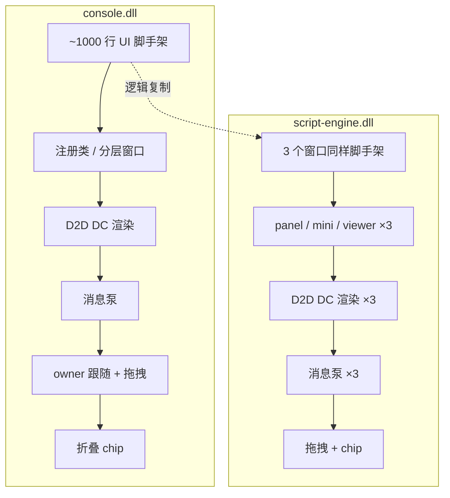
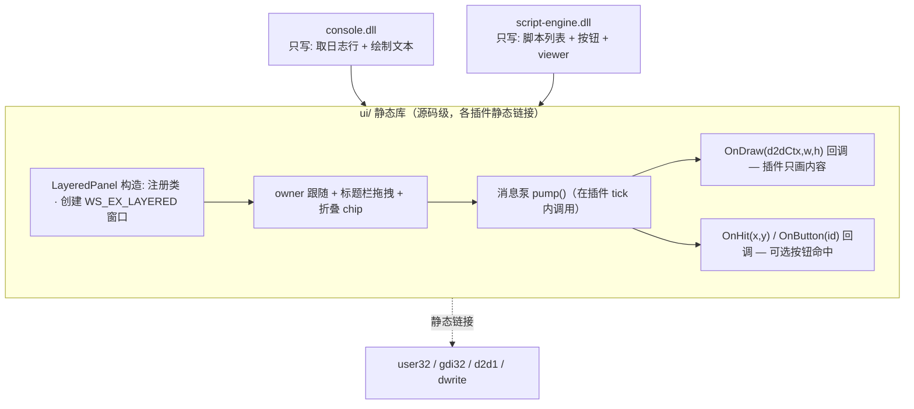

# PlusPlugin 项目架构图 6（方向：插件 UI 统一封装层 `ui/`）

> 本图是**架构图5**的延续决策。架构图5 已定：**GUI 属于插件自身，proxy 零图形、无独立 APP、无 IPC**。本图在该前提下进一步决定：各插件当前各自重写了一套几乎相同的分层窗口脚手架，**现抽出一层独立的 `ui/` 静态库供所有插件复用**，插件只写"内容绘制"与"按钮命中"。
>
> 依据（代码实测）：
> - `plugin/console/log_console.cpp`：约 1000 行窗口/渲染代码（注册类、`WS_EX_LAYERED` 窗口、D2D DC 渲染、`UpdateLayeredWindow`、消息泵、owner 跟随拖拽、折叠 chip）。
> - `plugin/script-engine/script_plugin.cpp`：重复同样的设施，且内部有 **3 个独立分层窗口**（panel / mini chip / viewer），每个都自带 WndProc、D2D 渲染、消息泵、chip，重复度更高。
> - 两套插件共有 **1500+ 行**高度雷同的 UI 脚手架，行为一致（dark rounded panel、拖拽、折叠 chip、DPI 跟随、owner 最小化隐藏）。抽封装收益大。

> 本版图小、每张只讲一件事：①现状（重复）②目标（封装层）③设计要点 ④API 草拟 ⑤收益与风险。

---

## ① 现状（无封装，重复实现）



> 两个插件都在 `tick()` 里自建窗口、自泵消息、自画 D2D、自管 owner 跟随与 chip——同一套东西写了两遍（script 写了三遍）。

## ② 目标（抽出 `ui/` 静态库）



> 插件不再碰窗口类注册、D2D 设备、消息循环、chip 切换——这些全部下沉到 `ui/`。插件通过回调拿到 D2D DC 渲染目标，只画自己的内容。

---

## ③ 设计要点

| 项 | 决策 |
|---|---|
| **封装位置** | 新增 `ui/` 源码库（**不是** framework 的 `.inc`）。插件是独立 DLL，不能链接 proxy 内部；但可源码级 `#include` 并静态链系统库，沿用 console/script 当前的 `/MT` 链接方式。 |
| **API 形态** | C 风格 + POD 结构，与现有 `sdk/pplugin.h` 的 ABI 风格一致；D2D 上下文用 `void*` 传（沿用 `render.inc` 的 `d2dCtx` 约定，库外不暴露 D2D 头）。 |
| **所有权/线程** | 窗口仍在插件 `tick()` 所属线程创建与泵消息（与现有约束一致：窗口消息队列属于创建它的线程）。`ui/` 只把这件事做成可复用函数，不改变线程模型。 |
| **绘制坐标系** | 逻辑像素（DPI scale 由 `ui/` 内部从 `Host::scale()` 取，回调拿到的 `w/h` 已是物理像素尺寸，插件按物理像素画或自行套 scale）。 |
| **ABI 边界** | `ui/` 是插件**内部**依赖，不进入 `Host` 能力表；插件仍只导出 `GetDesc`，framework 契约不变。 |

## ④ API 草拟（C 风格，供评审）

```c
// ui/panel.h —— 纯 C / POD，不含任何 D2D/DWrite 头
typedef struct PanelCbs {
    void (*draw)(void* ctx, void* d2dCtx, float w, float h); // d2dCtx: ID2D1DCRenderTarget*，void* 传
    int  (*hit)(void* ctx, float x, float y);                // 返回按钮 id，-1 表示空白
    void (*onButton)(void* ctx, int id);                     // 命中按钮回调
    void* ctx;
} PanelCbs;

HWND panel_create(const wchar_t* title, float w, float h, PanelCbs* cbs);
void  panel_pump(void);     // 插件 tick 内调用：泵消息 + 按需重绘
void  panel_destroy(void);  // 插件 shutdown 内调用
void  panel_invalidate(void); // 标记需重绘（替代各插件的 g_dirty 自旋）
```

- `draw` 里插件用传入的 `d2dCtx`（库内 `static_cast<ID2D1DCRenderTarget*>`）画文本/形状，无需自己建 D2D 设备或 DIB。
- 折叠 chip、拖拽、owner 最小化隐藏由 `ui/` 统一处理，插件无感。

## ⑤ 收益与风险

**收益**
- `console` 可砍掉约 80% 的窗口/渲染代码，只剩"取日志环形缓冲 + 画文本"。
- `script` 三个窗口合并复用同一套 `LayeredPanel`，viewer 作为第二个 `panel_create` 实例。
- 新插件零成本获得统一外观与交互（拖拽 / chip / DPI）。

**风险点（抽取时必须统一）**
- **DPI scale**：`Host::scale()` 的取值时机（首次 tick 拿到 owner 后），封装要缓存并在 owner DPI 变化时重建 surface。
- **owner 最小化**：`IsIconic` 时隐藏 panel+chip，恢复时按之前可见形态还原——当前散落在两插件，需归一。
- **chip 与 panel 切换**：折叠/展开状态机要统一，避免 console 与 script 行为漂移。
- **多窗口实例**：script 需要 panel + viewer 两个独立窗口，`ui/` 需支持"每插件多 panel 实例"（用 opaque handle 而非全局单例）。

## ⑥ 与现有文档的关系

| 文档 | 关系 |
|---|---|
| `架构图5.md` | 前置决策：插件自带窗口、proxy 零图形。本图在其之上加"统一 UI 封装层"。 |
| `plugin-framework.md` | 其第 1/2/8/10 节仍描述已删除的 D3D/overlay/render.inc，**与本图及架构图5 冲突**，待同步校正（不在本图范围）。 |
| `sdk/pplugin.h` | `ui/` 不改动 ABI 契约；它只是插件侧源码依赖。 |

## ⑦ 待确认 / 后续

- [ ] 是否要 `OnHit/OnButton` 通用按钮命中，还是各插件自己处理点击（console 几乎无按钮，script 按钮多）。
- [ ] `ui/` 的多实例 handle 形态：`HWND` 直接返回，还是封装成 `PanelHandle`（opaque struct）以隐藏 Win32 细节。
- [ ] 是否一并把 `plugin-framework.md` 校正到当前真实架构（与架构图5/6 对齐）。
- [ ] 落地顺序：先抽 `ui/` 让 `console` 接入验证，再迁移 `script` 的三个窗口。
